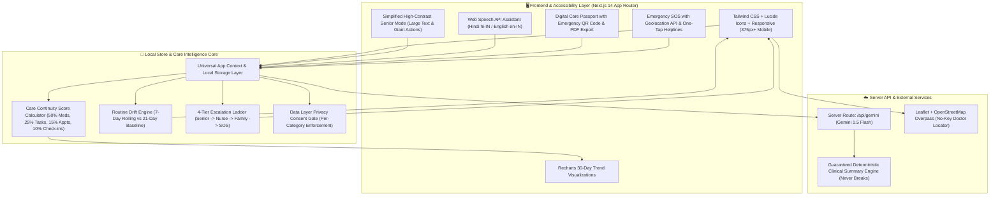

# 🧓 ELDERLY360

> **Noticing when elderly care quietly starts slipping.**  
> Proactive care continuity, routine drift detection, transparent explainable scoring, and automated multi-tier escalation.

---

## 📌 Problem Statement

Most senior care apps are merely glorified alarms: they beep to remind a senior to swallow a pill. But in real-world geriatric care, **deterioration happens quietly before emergencies strike**:
- A senior starts feeling fatigued and repeatedly misses their 8:30 PM diabetes dose.
- Morning garden walks slip from 6 days a week to 1 or 2 due to onset of mild joint stiffness.
- Family members living in another city or working busy jobs have no idea care patterns are decaying until an unexpected emergency room hospitalization occurs.

---

## 💡 The Solution: ELDERLY360

**ELDERLY360** transforms reactive emergency alarms into **proactive care intelligence**:
1. **Explainable Care Continuity Score (0–100)**: Mathematically transparent composite score ($50\%$ Meds + $25\%$ Tasks + $15\%$ Appointments + $10\%$ Check-ins), weighted toward recent days with plain-English reasons for score changes.
2. **Routine Drift Detection Engine**: Compares the last 7 days against a personalized 21-day baseline per activity and time-slot. Instantly detects when evening adherence drops by $\ge 30\%$ or an activity ceases.
3. **Automated Escalation Ladder**: Four-step progressive safety ladder: Senior gentle audio reminder $\rightarrow$ Caretaker alert $\rightarrow$ Family urgent SMS/push $\rightarrow$ Emergency SOS protocol.
4. **Senior-Controlled Privacy & Senior Mode**: Senior has granular autonomy to toggle what each family member or caretaker can see (medicines, scores, location, records), enforced in the data layer. Includes a giant-button, high-contrast Senior Mode and a bilingual Web Speech voice assistant in Hindi (`hi-IN`) and English (`en-IN`).
5. **Healthcare Ecosystem**: Emergency SOS with live Geolocation coordinates, OpenStreetMap doctor/clinic locator, digital Care Passport with Paramedic Emergency QR code, and server-side **Google Gemini 1.5** clinical summaries.

---

## 🏗️ Architecture Diagram



---

## 🚀 Key Features

### 🌟 Phase 1: Core Care Hub
- **Judging Demo Mode**: Instant 1-click role switcher on the landing page between **Senior (Ramesh Sharma, 72)**, **Family (Aarav Sharma - Son)**, and **Caretaker (Priya Singh - Nurse)** with **zero signup required**.
- **30-Day Seed Dataset**: Preloaded with 30 days of telemetry with a deliberate evening medication adherence drop in the last 6 days to immediately demonstrate routine drift.
- **Medication Management**: Add/edit prescriptions, mark doses taken/skipped/snoozed, dosage history, pill inventory, and predictive refill calculation (`Stock ÷ Daily Usage` $\rightarrow$ "Runs out in X days").
- **Daily Care Tasks**: Track walks, meals, hydration, and blood pressure/vitals logging.
- **Family & Caretaker Live Dashboard**: Real-time status of today's schedule, completion bars, and care circle invite codes (`RAMESH-360`).

### 🧬 Phase 2: Care Intelligence Engine
- **Care Continuity Score (0–100)**: Transparent calculation with weight disclosure and 30-day Recharts area chart.
- **Explainable Insights**: Plain-English reasons for score drops (e.g. *"Score fell 14 points: 4 of the last 6 evening doses missed, 2 walks skipped"*).
- **Routine Drift Detection**: Automatically compares the last 7 days vs the prior 21-day baseline. Generates drift cards when completion drops $>30\%$.
- **Automated Escalation Ladder**: Missed dose triggers a 4-step progressive timeline. Includes a **Simulate Time** button that fast-forwards missed doses in seconds for live judging demo!
- **Notification Feed**: Role-specific alert feed with real-time browser badges.

### 🛡️ Phase 3: Senior-Controlled Privacy & Accessibility
- **Consent Matrix**: Senior toggles what each family member and nurse can see across 5 categories (`medicines`, `score`, `location`, `records`, `appointments`). Enforced at the data layer!
- **Simplified Senior Mode**: Giant text, high-contrast dark theme, and **one primary action per screen** (*"Take my 8:00 PM Metformin"*).
- **Bilingual Voice Assistant (Web Speech API)**: Speaks reminders via `speechSynthesis` and recognizes Hindi and English voice commands (*"Dawa le li"*, *"What is my next medicine"*, *"Call my son"*, *"Emergency SOS"*).

### 🏥 Phase 4: Healthcare Ecosystem
- **Emergency SOS**: Big tactile button that captures live coordinates using browser Geolocation API and alerts family & caretakers with one-tap emergency call shortcuts (Ambulance 1066, Police 112).
- **Doctor & Hospital Locator**: Leaflet + OpenStreetMap locator for nearby cardiologists, endocrinologists, orthopedics, and 24x7 emergency centers.
- **Appointment Scheduler**: Book, reschedule, cancel, and mark appointments attended (directly feeding the Care Continuity Score).
- **Digital Care Passport**: Profile, conditions, allergies, active prescriptions, medical report upload, printable/PDF export view, and a paramedic emergency QR code.
- **Gemini-Powered Clinical Summary**: Server-side call to Google Gemini (`/api/gemini`) synthesizing 30-day telemetry into a 1-page pre-visit doctor briefing and suggested questions in English or Hindi, plus a weekly care summary for families.

---

## 🛠️ Tech Stack

- **Framework**: Next.js 14 (App Router, Server Components + API Routes)
- **Language**: TypeScript (Strict typing across all care entities)
- **Styling**: Tailwind CSS (Accessible contrast, healthcare color palette)
- **Data Visualizations**: Recharts (Responsive 30-day trend lines and areas)
- **Voice & Speech**: Web Speech API (`SpeechRecognition` & `SpeechSynthesis`)
- **Mapping**: Leaflet + OpenStreetMap (No API key required)
- **AI Integration**: Google Gemini 1.5 Flash (`/api/gemini`) with deterministic fallback
- **State & Storage**: Unified AppContext with local storage persistence and seed restoration

---

## 💻 Getting Started

### 1. Clone & Install Dependencies
```bash
git clone <repo-url>
cd ELDERY360
npm install
```

### 2. Configure Environment Variables
Copy `.env.example` to `.env.local`:
```bash
cp .env.example .env.local
```
Add your optional Gemini API key:
```env
GEMINI_API_KEY=your_gemini_api_key_here
```
*(Note: If `GEMINI_API_KEY` is not provided, the app uses its built-in deterministic clinical summary engine, so the application remains 100% functional during judging).*

### 3. Run the Development Server
```bash
npm run dev
```
Open [http://localhost:3000](http://localhost:3000) in your browser.

### 4. Build for Production
```bash
npm run build
npm run start
```

---

## 📄 License

This project is licensed under the [MIT License](LICENSE).
