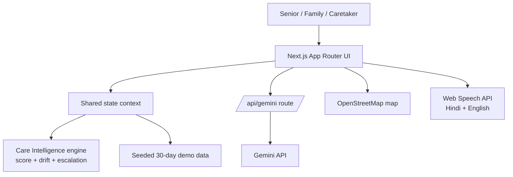

# ELDERLY360

**Proactive elderly care continuity: noticing when care quietly slips.**

🔗 **Live demo:** <your-vercel-link>
💻 **Repository:** https://github.com/Rinki781/Elderly360
🏆 Built for the **Makers Need More (MnM)** hackathon in 7 hours.

---

## The Problem

<paste the exact problem statement you chose>

Most elderly-care apps only send reminders. Nobody notices when care slowly breaks down: evening doses skipped, walks missed, check-ins fading. Families find out only after an emergency.

## Our Solution

ELDERLY360 brings the **senior, family members and caretakers** into one ecosystem, and adds a **Care Intelligence** layer that detects problems early:

- **Care Continuity Score (0-100):** an explainable score that tells you *why* it changed, in plain language.
- **Routine Drift Detection:** compares the last 7 days with the previous 21-day baseline per activity and time slot.
- **Smart Escalation Ladder:** missed dose → senior reminder → caretaker alert → family alert → SOS.
- **Senior-controlled privacy:** the senior decides what each family member can see.

## Key Features

| Area | Features |
|---|---|
| Medication | Schedules, taken/skip/snooze, adherence history, refill prediction |
| Care tasks | Daily tasks assigned to the senior or caretaker, vitals logging |
| Care Intelligence | Explainable Continuity Score, 30-day trend, drift cards, escalation timeline |
| Privacy and consent | Per-family-member visibility controls |
| Accessibility | Simplified Senior Mode, large buttons, Hindi/English voice assistant |
| Emergency | One-tap SOS, emergency contacts, Care Passport QR |
| Healthcare ecosystem | Nearby doctors/hospitals on an OpenStreetMap map, appointment management |
| Digital Care Passport | Conditions, allergies, medicines, records, emergency contacts |
| AI | Gemini-powered doctor-visit summary and care summaries |
| Roles | Senior, Family, Caretaker views with a role switcher |

## How the Care Continuity Score Works

| Factor | Weight |
|---|---|
| Medicine adherence | 50% |
| Daily care tasks and vitals | 25% |
| Doctor appointment attendance | 15% |
| Check-in consistency | 10% |

Recent days are weighted more heavily. Drift is flagged when an activity's completion in the last 7 days drops significantly against its 21-day baseline.

## Architecture



## Tech Stack

- **Framework:** Next.js (App Router), React, TypeScript
- **Styling:** Tailwind CSS
- **AI:** Google Gemini, called from a server-side API route
- **Maps:** OpenStreetMap
- **Voice:** Web Speech API (hi-IN, en-IN)
- **Deployment:** Vercel

## Run Locally

```bash
git clone https://github.com/Rinki781/Elderly360.git
cd Elderly360
npm install
cp .env.example .env.local
# add your GEMINI_API_KEY to .env.local
npm run dev
```

Open `http://localhost:3000`.

### Environment Variables

| Variable | Purpose |
|---|---|
| `GEMINI_API_KEY` | Gemini-powered doctor-visit summaries (a template summary is used if it is missing) |

## Demo Walkthrough (for judges)

1. Open the live link and click one of the roles under **Judging Demo Mode**. No signup is needed.
2. Use **View As** to switch between Senior (Ramesh), Family (Aarav) and Caretaker (Priya).
3. Open **Care Score (30d)** to see the explainable score and the recent slip.
4. Open **Routine Drift (3)** to see the evening-dose drift cards.
5. Press **Simulate Time** to advance the demo clock and watch the **Escalation Ladder** progress.
6. Open **Privacy & Consent** to control what family members can see.
7. Try **Senior Mode**, the **Voice Assistant**, **Emergency SOS**, **Care Passport (QR)** and **Doctor Visits & AI Brief**.

The demo uses 30 days of seeded data for Ramesh Sharma (72), with an intentional drop in evening adherence over the last 6 days.

## Project Structure

```
app/            Next.js pages, layout and the Gemini API route
components/     Feature components (dashboard, medication, drift, SOS, passport, ...)
context/        Shared application state
lib/            Care intelligence engine and seed data
types/          TypeScript types
```

## Known Limitations

- Demo data is seeded and stored on the client, so it is not synced across devices.
- Doctor and hospital listings are sample data for the demo.
- Escalation alerts are previews and do not send real SMS or WhatsApp messages.
- ELDERLY360 supports care coordination and is **not a substitute for professional medical advice**.

## Roadmap

- Cloud database and authentication so invite codes work across devices
- Real SMS/WhatsApp notifications
- Wearable and device integration
- More Indian languages
- ABDM (Ayushman Bharat Digital Mission) integration

## License

MIT
