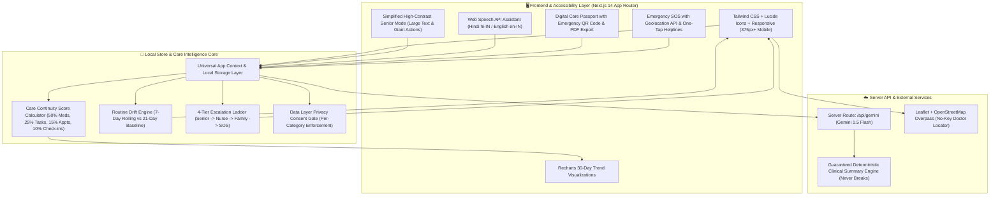

# 🧓 ELDERLY360

> **Noticing when elderly care quietly starts slipping.**  
> Proactive care continuity, routine drift detection, transparent explainable scoring, and automated multi-tier escalation.

---

## 📌 Problem Statement

Most senior care apps are merely glorified alarms: they beep to remind a senior to swallow a pill. But in real-world geriatric care, **deterioration happens quietly before emergencies strike**:
- A senior starts feeling fatigued and repeatedly misses their 8:30 PM diabetes dose.
- Morning garden walks slip from 6 days a week to 1 or 2 due to onset of mild joint stiffness.
- Family members living in another city or working busy jobs have no idea care patterns are decaying until an unexpected emergency room hospitalization occurs.

---

## 💡 The Solution: ELDERLY360

**ELDERLY360** transforms reactive emergency alarms into **proactive care intelligence**:
1. **Explainable Care Continuity Score (0–100)**: Mathematically transparent composite score ($50\%$ Meds + $25\%$ Tasks + $15\%$ Appointments + $10\%$ Check-ins), weighted toward recent days with plain-English reasons for score changes.
2. **Routine Drift Detection Engine**: Compares the last 7 days against a personalized 21-day baseline per activity and time-slot. Instantly detects when evening adherence drops by $\ge 30\%$ or an activity ceases.
3. **Automated Escalation Ladder**: Four-step progressive safety ladder: Senior gentle audio reminder $\rightarrow$ Caretaker alert $\rightarrow$ Family urgent SMS/push $\rightarrow$ Emergency SOS protocol.
4. **Senior-Controlled Privacy & Senior Mode**: Senior has granular autonomy to toggle what each family member or caretaker can see (medicines, scores, location, records), enforced in the data layer. Includes a giant-button, high-contrast Senior Mode and a bilingual Web Speech voice assistant in Hindi (`hi-IN`) and English (`en-IN`).
5. **Healthcare Ecosystem**: Emergency SOS with live Geolocation coordinates, OpenStreetMap doctor/clinic locator, digital Care Passport with Paramedic Emergency QR code, and server-side **Google Gemini 1.5** clinical summaries.

---

## 🏗️ Architecture Diagram



---


## 💻 Getting Started

### 1. Clone & Install Dependencies
```bash
git clone <repo-url>
cd ELDERY360
npm install
```

### 2. Configure Environment Variables
Copy `.env.example` to `.env.local`:
```bash
cp .env.example .env.local
```
Add your optional Gemini API key:
```env
GEMINI_API_KEY=your_gemini_api_key_here
```
*(Note: If `GEMINI_API_KEY` is not provided, the app uses its built-in deterministic clinical summary engine, so the application remains 100% functional during judging).*

### 3. Run the Development Server
```bash
npm run dev
```
Open [http://localhost:3000](http://localhost:3000) in your browser.

### 4. Build for Production
```bash
npm run build
npm run start
```

---

## 📄 License

This project is licensed under the [MIT License](LICENSE).
