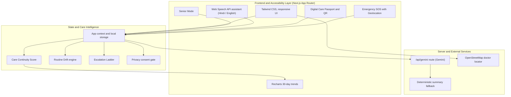

# 🧓 ELDERLY360

**Noticing when elderly care quietly starts slipping.**

Proactive care continuity, routine drift detection, explainable scoring and automated multi-tier escalation.

🔗 **Live Demo:** https://elderly360-nine.vercel.app
💻 **GitHub:** https://github.com/Rinki781/Elderly360
🏆 Built in 7 hours for the **Makers Need More (MnM)** hackathon.

> Open the live demo and click any role under **Judging Demo Mode**. No signup is needed.

---

## 📌 The Problem

Most senior care apps are glorified alarms: they beep to remind a senior to take a pill. But in real geriatric care, **deterioration happens quietly before emergencies strike**:

- A senior feels fatigued and repeatedly misses the 8:30 PM diabetes dose.
- Morning walks slip from six days a week to one or two because of joint stiffness.
- Family members in another city have no idea care patterns are decaying until an emergency hospitalization.

Existing apps remind. None of them notice.

## 💡 Our Solution

ELDERLY360 turns reactive alarms into **proactive care intelligence**, bringing the **senior, family members and caretakers** into one ecosystem:

1. **Explainable Care Continuity Score (0-100):** a transparent score (50% medicines, 25% tasks, 15% appointments, 10% check-ins) that explains in plain language why it changed.
2. **Routine Drift Detection:** compares the last 7 days with a personalized 21-day baseline per activity and time slot, and flags significant drops.
3. **Automated Escalation Ladder:** senior reminder → caretaker alert → family alert → emergency SOS.
4. **Senior-controlled privacy:** the senior decides what each family member or caretaker can see (medicines, score, records, appointments).
5. **Accessibility:** a simplified high-contrast Senior Mode with large buttons, and a Hindi (`hi-IN`) and English (`en-IN`) voice assistant.
6. **Healthcare ecosystem:** SOS with geolocation, an OpenStreetMap doctor locator, a Digital Care Passport with an emergency QR code, and Gemini-powered doctor-visit summaries.

## ✨ Key Features

| Area | Features |
|---|---|
| Medication | Schedules, taken/skip/snooze, adherence history, refill prediction |
| Care tasks | Daily tasks for the senior or caretaker, vitals logging |
| Care Intelligence | Explainable score, 30-day trend, drift cards, escalation timeline |
| Privacy and consent | Per-family-member visibility controls |
| Accessibility | Senior Mode, large buttons, Hindi/English voice assistant |
| Emergency | One-tap SOS, emergency contacts, Care Passport QR |
| Healthcare ecosystem | Nearby doctors and hospitals on a map, appointment management |
| Digital Care Passport | Conditions, allergies, medicines, records, emergency contacts |
| AI | Gemini-powered doctor-visit summary |
| Roles | Senior, Family and Caretaker views with a role switcher |

## 🧮 How the Care Continuity Score Works

| Factor | Weight |
|---|---|
| Medicine adherence | 50% |
| Daily care tasks and vitals | 25% |
| Doctor appointment attendance | 15% |
| Check-in consistency | 10% |

Recent days are weighted more heavily. Drift is flagged when an activity's completion over the last 7 days drops significantly against its 21-day baseline.

## 🏗️ Architecture



## 🛠️ Tech Stack

- **Framework:** Next.js (App Router), React, TypeScript
- **Styling:** Tailwind CSS, Recharts
- **AI:** Google Gemini, called from a server-side API route
- **Maps:** OpenStreetMap
- **Voice:** Web Speech API (hi-IN, en-IN)
- **Deployment:** Vercel

## 💻 Run Locally

```bash
git clone https://github.com/Rinki781/Elderly360.git
cd Elderly360
npm install
cp .env.example .env.local
npm run dev
```

Open [http://localhost:3000](http://localhost:3000).

### Environment Variables

Add your optional Gemini key to `.env.local`:

```env
GEMINI_API_KEY=your_gemini_api_key_here
```

If `GEMINI_API_KEY` is missing, the app uses its built-in deterministic summary engine, so everything keeps working. The Firebase variables in `.env.example` are optional.

### Production build

```bash
npm run build
npm run start
```

## 🎬 Demo Walkthrough (for judges)

1. Open https://elderly360-nine.vercel.app and click a role under **Judging Demo Mode**.
2. Use **View As** to switch between Senior (Ramesh), Family (Aarav) and Caretaker (Priya).
3. Open **Care Score (30d)** to see the explainable score and the recent slip.
4. Open **Routine Drift** to see the evening-dose drift cards.
5. Press **Simulate Time** to advance the demo clock and watch the **Escalation Ladder** progress.
6. Open **Privacy & Consent** to control what family members can see.
7. Try **Senior Mode**, **Voice Assistant**, **Emergency SOS**, **Care Passport (QR)**, **Doctor Visits & AI Brief** and **Nearby Doctors & Maps**.

The demo uses 30 days of seeded data for Ramesh Sharma (72), with a deliberate drop in evening adherence over the last 6 days.

## 📁 Project Structure

```
app/          Next.js pages, layout and the Gemini API route
components/   Feature components (dashboard, medication, drift, SOS, passport, ...)
context/      Shared application state
lib/          Care intelligence engine and seed data
types/        TypeScript types
```

## ⚠️ Known Limitations

- Demo data is seeded and stored on the client, so it is not synced across devices.
- Doctor and hospital listings are sample data for the demo.
- Escalation alerts are previews and do not send real SMS or WhatsApp messages.
- ELDERLY360 supports care coordination and is **not a substitute for professional medical advice**.

## 🗺️ Roadmap

- Cloud database and authentication so invite codes work across devices
- Real SMS and WhatsApp notifications
- Wearable and device integration
- More Indian languages
- ABDM (Ayushman Bharat Digital Mission) integration

## 📄 License

This project is licensed under the [MIT License](LICENSE).
